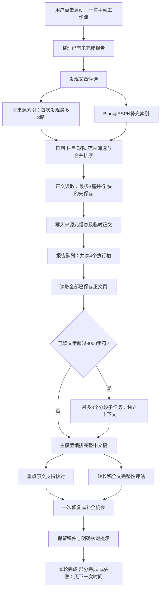

# V7.5：新闻工具链、等待点与阶段实测

记录时间：2026-09-23，北京时间 11:35 初始分析，11:42 后追加第 9 节实现复测，11:57 后追加第 10 节手动强制刷新作用域修复。代码是 `0de29d2` 之后尚未提交的工作区快照。本文区分已完成的实测、代码推断和后续建议；不是最终品质验收结论。

## 1. 目前能确认什么

现有采集流水线已经限制并发、共享同一请求、保存部分成功，并保留正文与来源范围检查。最大的确定性等待点在**索引全部结束之后才开始读文章**，而不是 HTML 解析计算本身。分析时，默认采集还会等主索引完成后再访问 Bing/ESPN，形成第二段网络等待；本轮随后已重叠这部分等待，变更与复测见第 9 节。

已有模型实测显示，生成轮次和排队时间明显减少；长稿仍主要耗在主稿生成、分段候选及模型排队。`source_read_ms` 很小不能证明互联网读取很快：验收脚本先下载文章，再进入 Agent 的已读文本处理，这两个阶段的计时分开了。

原文支持核对和正文完整性评估是不同工作。按维护者最新要求，新闻稿保留足够内容，语义核对/完整性评估未完成或部分存疑时给统一提示；引用对应关系、球队/隐私范围和来源版本仍是硬边界。`completed` 因而不等于“全文每句话已核验”。

证据：`server/research.py:542–642,765–810`；`server/agent.py:430–462,640–699`；`output/live_news_acceptance.py:30–55`。

## 2. 一次手动更新如何经过系统

图中的网络和模型并行都只属于本次用户操作。启动服务、读取页面和时间流逝不会启动新一轮。已有报告队列目前在新增采集之前处理，二者还不是流式重叠：`server/workflows.py:197–237`。

并发限制分四层，不能只看一个数字：

| 层次 | 当前限制 | 作用与依赖 |
|---|---:|---|
| 单次发现 | 3 个主来源 | `_source_index` 和部分来源的日期补查占用该槽，见 `research.py:552–575` |
| 同一 Store 的来源传输 | 总 4、每 host 2 | 多球队共享；先拿 host 槽，再拿全局槽，见 `research_transport.py:10–12,59–104` |
| 报告处理 | 4 个报告 | 跨球队共享信号量，见 `news_reports.py:28,44–49,759` |
| 模型请求 | 总 6、每服务 origin 4 | 起草、分段、核对共用；按根任务轮转，见 `model_harness.py:25–74` |

真实子任务另有每根最多 12 个活跃后代的运行时限制，见 `agent_runtime.py:78,189–192`。四个报告同时各派三个子任务时，不能假设所有 12 个分段都能同时启动：报告执行本身也可能是该根的后代。应测量实际占用，再调整分段扇出，不应简单叠加并发上限。

## 3. 来源工具的等待点（优化前快照）

### 主索引与补充搜索

`collect_team(query="")` 请求的候选上限固定为 40，即便只需要读取 1 或 5 篇。`discover_news` 先收齐所有主来源结果；无查询词时，只有主候选数小于 `limit + offset` 才启动 Bing 和 ESPN。显式查询词已经让补充索引与主索引同时启动，但最后仍统一等待再排序。因此“官网已经有足够文章”并不一定让第一篇正文提前读取。

证据：`server/research.py:578–594,616–642,765–772`。这不等于两个补充来源没有价值：它们补充媒体视角、弥补索引缺项，并接受相同的日期和球队范围筛选；优化应重叠等待，而不是删掉这些来源。

本地延迟探针通过真实 `discover_news/collect_team`，仅替换网络边界，不访问外网或模型。每种情况只测一次，毫秒差异包含解释器调度和候选处理开销。

| 情景 | 快主源 | 慢主源 | 补充索引延迟 | 第一篇正文开始 |
|---|---:|---:|---:|---:|
| 无 query，需要 1 篇，快源有 10 候选 | 20 ms | 150 ms | 120 ms | 290.9 ms |
| 显式 query，相同延迟 | 20 ms | 150 ms | 120 ms | 173.6 ms |
| 无 query，快源有 40 候选，无需补充索引 | 20 ms | 150 ms | 未启动 | 197.9 ms |
| 显式 query，主源都快、搜索慢 | 20 ms | 20 ms | 300 ms | 312.8 ms |

原始记录：`output/architecture-v75-probes.json:1–67`，时间 `2026-09-23T03:32:09Z`。前两行证明有一段可重叠的串行等待；第三、四行证明“等待全部索引”仍是单独的瓶颈。这些不是生产网络提速百分比。

### 失败冷却与强制刷新

同一 URL 的失败冷却为 30 秒；连接/超时错误另有 host 冷却，同站后续文章可快速失败，其他站仍继续。HTTP 403 只记该请求失败，不把整个站判死，避免一篇受限文章影响同站其他公开文章。索引本身有 10 分钟成功缓存；错误时可保留不超过 24 小时的旧索引，并明确标注陈旧。见 `research_transport.py:59–104`、`research.py:381–421`。

实际 Guardian 探针：第一篇连接失败花 8.027 秒，同 host 第二篇立即返回既有失败（记录 0.000 秒）。这证明冷却能消除重复等待，不能证明该来源已恢复可读。AS 一篇正文成功（5503 字符、2.474 秒），另一篇 0.569 秒返回 403，也说明不能把单篇 403 等同于整个出版社不可用。见 `output/source-probe-2026-09-23-after.json:8–69`。

初始分析时，`force=True` 逐请求清除 URL 和 host 失败记录；手动新闻工作流把 force 传到本轮采集，读取候选也继续传递。一轮内新遇到的连接失败因此会被下一次强制读取绕过。该问题随后按“操作开始前的旧失败可重试、本轮新失败仍生效”修复，见第 10 节。原问题位置以初始哈希快照为准：`workflows.py:226`、`research.py:732,777`、`research_transport.py:63–69`。

### 日期验证与重复读取

TyC 索引不提供文章日期；有时间窗口时，最多补读 3 条匹配文章核实发表时间。日期未核实的记录不应伪装成近期新闻。补查只保存日期元数据，正文读取阶段还会再次访问已匹配 URL；传输协调器只共享进行中的请求，不缓存成功响应。这是一处可以进一步验证的重复下载成本，不能用猜日期来省掉。见 `research.py:424–453,719–738`、`research_transport.py:1,108–118`。

### 正文读取与“分页”

文章读取已经采用最多 3 路、`FIRST_COMPLETED` 补位，快文章可以在慢文章结束前保存；失败不回滚已完成内容。尝试上限是 `min(候选数, limit+3, max_attempts)`，它是文章选择范围，不是对已选文章正文的摘要长度限制。见 `research.py:772–810`、`tests/test_research_concurrency.py:394–416`。

新闻 Agent 在起草前按 `next_offset` 读完本次可见文字，每页 12000 字符；passage 不超过 700 字符，不能跨未读区间编造引用。这里的分页是**已提取文本的字符分页**，不是任意网页“下一页”的网络爬取。HTML 提取本身最多保留 30000 字符，并携带截断标记。已读全文、提取全文和网站原始全文是三个不同范围。见 `agent.py:430–462`、`agent_tools.py:174–196,386–407,813–822`、`ingestion.py:24–29`。

取消同步网络读取时，线程未必能立即停止。传输协调器会等真实线程退出后再释放并发槽，避免快速取消造成隐性并发超限；这是应保留的资源边界，不应为表面上的取消速度提前释放。见 `research_transport.py:17–56`。

## 4. 实际采集覆盖：不要混用不同分母

| 默认采集球队 | 总时间 | 尝试文章数 | 本次筛出的 full_text |
|---|---:|---:|---:|
| 巴塞罗那 | 30.662 s | 1 | 1 |
| 国际米兰 | 36.286 s | 5 | 3 |
| 皇家马德里 | 38.133 s | 8 | 3 |
| 阿森纳 | 39.617 s | 5 | 5 |
| 利物浦 | 39.707 s | 5 | 0 |

这些是同一个临时 Store 下五队并行的默认采集（每队目标 5 篇、7 天窗口、最多 8 次文章尝试），共享来源网络槽。五队均为 partial；记录了 Guardian 连接失败及 ESPN 新闻索引不可用，皇马还有 AS 个别文章 403。所有队的补充搜索开始时间约为 `02:57:58Z`，主来源开始时间约为 `02:57:33Z`，可看到补充阶段被延后；这些时间戳是尝试开始，不足以分解每个 host 的实际排队/下载耗时。

五次默认采集共得到 12 篇被样本脚本认定为 `full_text` 的文章。之后补读 8 篇，才形成 20 篇、10 队的模型样本。不能把最终 20 篇说成“五队默认采集一次直接取得 20 篇”，也不能把利物浦的 0 篇 full_text 说成该队没有新闻：它有 5 次文章读取，full_text 是样本过滤条件。

证据：`output/real-source-samples-2026-09-23.json:1–355,869–911`；`output/collect_source_samples.py:15–29`；`output/supplement_source_samples.py:24–32`。TyC 和 AS 的单源探针分别取得 15 和 50 个索引候选，但这不是球队相关候选数，也不是可读正文数。

## 5. 已完成模型批次：速度可观察，品质另验

以下只使用已经完成的 `v75-paired-baseline` 与 `v75-final-live`，两者都是 20 个 URL、批次并发 4。后续精简新闻提示词、年份检查和 `>3000` 字符完整性评估的复测写入 `output/v75-acceptance`，本文不把进行中的数据混入此表。

| 指标 | paired-baseline | final-live |
|---|---:|---:|
| 完成稿件 | 13 / 20 | 20 / 20 |
| 全批次墙钟时间 | 361.29 s | 194.94 s |
| 全 20 条单条中位数 | 68.531 s | 27.622 s |
| 双方都完成的 13 条，中位数 | 74.803 s | 26.503 s |
| 双方都完成且正文长度相同的 11 条，中位数 | 74.803 s | 29.200 s |
| 单条 P95，20 条取排序第 19 条 | 111.499 s | 79.383 s |
| 最慢单条 | 124.724 s | 96.249 s |

基线有 2 条来源不可用，计时是 0 秒，另 5 条稿件失败；final-live 的 20 篇都进入发布层，其中 16 篇 `review_status=checked`，4 篇 `partial`。稿件发布规则及来源适配器也变了，不能把完成数变化全部归功于并发。20 个 URL 配对相同，但 6 条正文长度不同或基线没有正文；相同长度也不是字节相同的证明。该样本不足以推出生产长期成功率或最终品质得分。

输出字数中位数按全批次是 772→975，但基线把失败稿记为 0；双方都完成的 13 条是 974→943。应查看具体文章是否保留了事实和条件，不能把字数中位数上升当作完整性已改善的证据。长稿 case 12 为 3378→5491 字符；case 14 则为 1217→488，后者需内容对照，单凭字数不能判定遗漏。

证据：`output/v75-paired-baseline/summary.json:1–9`、`output/v75-final-live/summary.json:1–9`；各自 `results.json` 的按 case 配对统计。具体长稿：基线 `results.json:418`、final-live `results.json:807`；case 14：基线 `:575`、final-live `:696`。

### 时间花在哪里

| 指标 | 基线（18 条有 Agent metrics） | final-live（20 条有 metrics） |
|---|---:|---:|
| 逻辑模型请求总数 | 87 | 75 |
| 起草调用数 | 57 | 37 |
| 起草执行时间合计 | 620.611 s | 558.084 s |
| 核对类调用数 | 30 | 30 |
| 核对类执行时间合计 | 99.480 s | 77.453 s |
| 模型队列等待合计 | 625.387 s | 75.791 s |
| 分段调用数 / 执行合计 | 0 / 0 s | 8 / 80.330 s |

合计是所有请求的资源时间，不是批次墙钟时间；同一稿件的子任务、支持核对和完整性检查会重叠。final-live 等待中位数为 0.5 ms，但最长单篇累计等待仍为 25.439 秒。生成仍是主要消耗，不是“核验全部拿掉就会很快”。

final-live 的 `source_read_ms` 合计 429 ms、中位数 4 ms，只计 Agent 阅读当前已保存文字；验收脚本在此之前的 `_fetch_shared/extract_html/ingest` 仍计入单条 `seconds`，没有单独阶段字段。不能据此认定外网 HTML 只花 4 ms。见 `output/live_news_acceptance.py:33–55`。

## 6. 分段、重点核对与完整性评估怎么衔接

- 当前超过 8000 个已读字符的新闻进入分段。每片约 4500–5500 字符，不拆已有 passage；最多三个真实子任务，独立消息与会话 ID，相邻一段只作语境。主模型仍收到完整已读原文。见 `news_sections.py:18–20,41–70,122–138,159–199`、`agent.py:526–533`。
- 分段提纲的 passage ID 必须属于该片核心段落；未覆盖的 ID 以及失败片段明确返回给父任务。`news_section_failures=len(errors)` 同时包含“提纲未覆盖部分段落”的提示，不能直接解释成失败子任务数量。final-live 三篇长稿计划 8 片、记录 2 条错误/覆盖提示，不能据此断言 2 个子模型请求失败。
- 当前代码在超过 3000 字符时将原文支持核对与完整性评估并行；`final-live` 只记录了三篇 coverage，反映的是之前运行快照，不能用当前门槛重新解释过去样本。新门槛的实测应看完成后的 `v75-acceptance`。见 `agent.py:640–652`。
- 完整性评估比较完整已读文字与候选稿，返回明确遗漏项；来源变化、输入不完整或超时均为 unavailable，而非“没有遗漏”。结构无效最多独立重试一次，共享同一个时间预算。见 `news_coverage.py:45–92,148–214`。
- 新闻最多有一次补全/修复机会。核对未完成、语义存疑或局部漏项不会强制把整篇压成短摘要；父任务保留稿件并给统一提示。引用伪造、来源越界和版本变化仍不能用提示代替。见 `agent.py:657–706`。

## 7. 逐步跟踪需要补齐的观测口径

当前 `model_harness` 每个请求保留 owner/root/role/stage、排队、执行与总时间；Agent 合并成 draft/section/verification 的次数和毫秒。传输重试现已在发送前计数，失败和取消也能计入实际 HTTP 尝试；不能把逻辑调用数直接当真实请求数。见 `model_harness.py:78–118`、`agent.py:271–304`。

还缺少以下局部观测，建议先加指标，再决定下一个改动：

| 阶段 | 最小有用记录 | 解决的问题 |
|---|---|---|
| 单源索引 | 入队、获 host/全局槽、连接/读取结束、解析结束、候选数 | 区分网站慢、排队慢和页面规则失效 |
| 补充索引 | 启动原因、启动时间、是否最终采用、取消时间 | 知道一次 speculative 请求是否值得 |
| 日期补查 / 正文 | 同 URL 是否重复请求、下载与提取耗时、正文状态、首篇保存时刻 | 识别重复下载及首次内容展示延迟 |
| 工具调用 | 开始/结束时间、工具名、结果条数、失败类别 | 当前步骤状态不是完整的工具级耗时分解 |
| 长稿 | 规划片数、成功片数、未覆盖 passage 数、提纲墙钟时间 | 将“失败”和“覆盖警告”分开 |
| 语义支持 / coverage | 不同 stage，分别记录请求数、耗时与状态 | 目前都走 verify_request，被合并为 verification |

记录 URL 时采用现有规范化标识或哈希；不记录凭据、原始模型私有推理或长期外文正文。新增指标先使用现有运行记录和步骤，不另建一套 Agent 框架。

## 8. 接下来只做必要优化

1. **重叠默认采集的补充索引等待（本轮已实施，见第 9 节）。** 主索引先入队，Bing/ESPN 在本次调用内并行；依旧按原先规则决定是否纳入排序。无需补充时及时取消，缓存已足够时跳过。收益是去掉串行等待，代价是部分冷启动会多发最多两个最终不用的逻辑索引任务；不能把它变成后台定时预取。
2. **再研究从候选到正文的流式衔接。** 快源中经过相同球队/日期检查的候选先读，慢源继续补齐原范围；保留来源多样性、排名与版本检查。不要只因已有一篇成功就取消其余必要范围。现有正文保存已支持部分成功，可复用，不需重写采集器。
3. **减少日期补查后的同 URL 再下载。** 只在当前调用或既有受限临时缓存内复用已验证正文；仍校验 URL、球队、版本和日期，不建立持久原文库。
4. **保持新失败的 host 冷却（本轮已实施，见第 10 节）。** 将一次操作的显式强制重试和该操作内部的后续请求区分，用户再次点击仍可重试旧失败。
5. **按实际资源图控制长稿扇出。** 保留每段完整提纲与父稿全文，优先观察 root 活跃任务和每服务模型槽；必要时动态减少同时分段数，而不是减少段数或截短正文。

这些优化不要求换框架、换数据库或把全部模块重写。验收按来源可读、中文稿生成、关键事实核对、完整性提示分别报告；最终品质结论等待独立内容复评。

## 9. 本轮实施：仅重叠可确定的串行等待

文档初稿落地后，维护者授权实施第 8 节第一项。`discover_news` 先创建主索引任务并让出一次调度，使它们先进入现有请求队列，再在本次调用内启动 Bing/ESPN。主索引完成后仍按原来的 `显式 query 或主候选数不足 limit+offset` 判定是否纳入补充结果；没有降低候选上限、日期检查或来源多样性规则。

主索引结果已由缓存立即满足时，不创建补充任务；发现主索引已足够时，取消并等待不需要的补充任务收尾，不把其结果或错误混入此次覆盖状态。父调用取消时，同样清理主索引和两个补充任务。实际不可取消的同步下载仍由原有协调器持有槽位直到线程退出。

代码：`server/research.py:578–603`。测试可按 `test_default_discovery_overlaps_fallback_after_publishers_start` 至 `test_cancelling_default_discovery_cleans_publishers_and_speculative_search` 定位（第 10 节新增测试前位于 `tests/test_research_concurrency.py:432–513`）。新增测试先在原代码上证明空 query 无法与补充搜索重叠，再验证先启动主来源、补充失败时保留主源成功、主源足够时排除并取消补充、完整缓存不发多余请求，以及父取消清理。

| 同一 mock 情景 | 优化前首篇开始 | 优化后首篇开始 | 解释 |
|---|---:|---:|---|
| 无 query，10 个候选，慢主源 150 ms、补充 120 ms | 290.9 ms | 174.4 ms | 该探针省约 116.5 ms，串行等待变为重叠 |
| 显式 query，相同延迟 | 173.6 ms | 172.9 ms | 原已重叠，差异属于调度波动 |
| 无 query，40 候选已足够 | 197.9 ms | 197.1 ms | 仍须等慢主源；此次额外启动两个最终未采用的逻辑索引任务 |
| 显式 query，搜索慢 300 ms | 312.8 ms | 316.3 ms | 搜索本身仍在关键路径，没有声称解决这一瓶颈 |

这是各情景各一次的受控延迟探针，不能外推生产提速比例。额外代价至多是两个本次调用内的索引任务，不等于至多两个底层 HTTP 交换：各适配器仍可能重定向或进行既有限定重试。主索引先入队不等于传输协调器有永久优先级；补充任务仍占共享四个槽，真实多球队场景需观察它们是否延后后续主来源。未新增付费模型调用或后台周期任务。第 9 节实现时未改 host force 语义；后续修复单列于第 10 节。

复测记录追加于 `output/architecture-v75-probes.json` 的 `results_after`，保留原 `results`。相关五个测试模块共 **86/86 通过**（research、research_concurrency、research_enhancements、news_sources、personal_research）。这些验证覆盖调度与原范围保持，不代替最终新闻品质验收。

## 10. 本轮实施：强制刷新只重试操作开始前的失败

`collect_team(force=True)` 和 `discover_news(force=True)` 通过 ContextVar 共享一次操作的起始时刻；子任务自然继承，嵌套调用不重置。退出、异常和取消都恢复原上下文。失败记录在内存中同时记录发生时间，force 仅清除早于本次操作开始的 URL/host 失败。本轮新连接失败继续冷却，且在取得 host 槽、取得全局槽后分别重查，避免等待队列中的请求随后再次访问已失败站点。

单独的显式 force 请求若没有外层作用域，以自身调用起点为边界，仍能重试旧失败。成功索引和正文的 force 刷新未被缓存吞掉；HTTP 404 仍只冷却当前 URL，另一篇同站公开文章仍能读取。这些时间戳和作用域均只在进程内使用，没有持久定时任务。

代码：`server/research_transport.py:16–32,76–130`；入口：`server/research.py:543,773`。测试：`tests/test_research_concurrency.py:93–238`。

| 验证场景 | 修复前实际观察 | 修复后 |
|---|---:|---:|
| 一次强制采集，5 个同站候选立即连接失败 | 实际访问 5 次 | 实际访问 1 次，其他 host 成功保留 |
| 同样操作再手动启动一次 | 不区分本轮与旧失败 | 第二轮允许重新访问 1 次，两轮合计 2 次 |
| 已拿到 host 槽，但排队等待全局槽时同站先失败 | 仍实际访问 2 次 | 第二个请求被新冷却拦住，实际 1 次 |
| 6 个同站候选，最初已有 2 个下载在途 | — | 允许这 2 个结束；处理完 6 个候选也没有再启动第 3 个下载 |
| 嵌套强制发现、404、取消后新重试、成功正文刷新 | 旧逻辑的前两类反例已复现 | 全部回归通过 |

测试先观察到旧代码的 5→预期1、2→预期1 等失败，再验证修复。五个相关模块 **92/92 通过**，随后补充的“两个请求已在途”用例单独通过；最终全量检查由发布流程执行。`output/architecture-v75-probes.json` 追加了 `force_scope_validation` 和代码哈希。

这使前面 Guardian “一次慢失败、后续快速冷却”的机制也适用于实际手动工作流。但本次新证据是无网络回归，不把此前 8.027 秒的真实测量伪装成又做了一次实时联网验收。

## 证据快照与可复查性

初稿只读取代码和输出 JSON，使用局部 mock 延迟；后续经授权修改第 9、10 节的调度与作用域及相关测试。未读取配置数据库/key，未额外调用付费 API。局部探针为 `output/architecture-v75-probes.json`。

分析初始快照的关键代码 SHA-256 前 16 位（便于区别后续工作区变化；第 9 节修改后的 research 哈希另存于探针文件 `research_sha256_after`）：

| 文件 | 快照 |
|---|---|
| `server/research.py` | `289668d4c9f6daf3` |
| `server/research_transport.py` | `2b713c9206a2e6bf` |
| `server/agent.py` | `aaa7a65d36310d0a` |
| `server/news_sections.py` | `244b969da0c5b6f4` |
| `server/news_coverage.py` | `e76f3e5c03adff5a` |
| `server/model_harness.py` | `4f0033b6350ca242` |

后续实现或验收文件发生变化时，应保留本节的“阶段快照”含义，并单独追加新证据，不把新阈值或新结果倒填成旧测试的结论。
