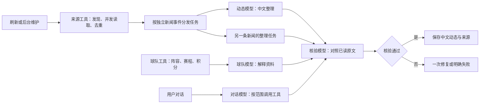

# 看台 V7.1 运行协调与多模型分工

协调层将跟队工作分为公开资料采集、中文整理和原文核验。独立新闻事件并行执行；同一事件必须先读到资料，再整理，再核验。比分、赛季、阵容等确定事实始终由数据工具维护，不交给模型猜测。

## 模型角色

| 角色 | 用途 | 允许的输入 |
| --- | --- | --- |
| feed | 新闻整理 | 本事件实际读过的来源、阅读偏好 |
| chat | 足球对话 | 当前球队、当前会话和可访问证据 |
| team | 球队与球员解读 | 已核对身份及赛季的结构化资料 |
| verify | 独立原文核验 | 候选主张、真实引文及必要上下文；没有私人会话历史 |

前三个角色未指定时继承默认模型。verify未指定时跟随当前任务模型，但仍以独立上下文请求；指定后可以由另一模型核验。现有会话保持原模型绑定，角色设置影响后续新任务。系统不会自动添加、购买或轮换未配置的模型。

## 工具、技能与执行控制

- `research.py`与`research_transport.py`负责来源发现、解析、在途请求共享、失败冷却和读取后权限复核。工具返回成功来源及失败原因；部分失败不等于没有新闻。
- `agent_skills/`规定先读当前资料、识别缺口、再针对性补充。技能不能扩大球队、比赛、隐私、时间或联网范围。外部新闻正文仅在受限内存中临时缓存。
- `team_center.py`按阵容、赛程、积分、照片维护状态。缺项和过期独立展示，照片不阻塞核心资料；维护工具可传parts定向更新。
- `news_reports.py`为独立事件建立可追溯的报告与运行记录，手动批次优先，避免重复整理同一报告。
- `model_harness.py`管理模型请求等待、执行和取消，记录角色、模型、等待时间与耗时，不保存密钥、推理过程或完整请求内容。
- `agent_progress.py`识别相同结果的连续或交替重复；新增阅读范围或新结果允许继续研究。没有每日篇数或固定研究轮数配额。

并发边界：模型请求最多同时3个、同一服务地址最多2个；独立报告最多2条；文章读取最多3篇；新闻网络请求每库最多4个、同站最多2个；核心球队维护最多2队。这些限制控制并发压力，不截断用户需要的总研究量。

总任务时限约30分钟，包括排队。单次模型执行时限从取得调度槽后计算，避免排队吞掉核验时间。核验不接收生成模型的私人上下文；不同服务商凭据由服务端分别读取。

## 完成、失败与取消

新闻只有在引用属于本次已读范围且整篇独立核验通过时才发布。来源或权限在整理期间变化，会重新检查有效性。固定来源中单篇网络失败时保留成功材料并说明缺口；范围不允许的内容不能通过降级获得引用资格。

请求取消会向下传播并等待子任务结束；排队期间取消不发出模型请求。普通对话使用现有停止入口。服务关闭时中断并清理后台报告与维护任务，重启恢复不会把半成品当作完成。后台报告尚未提供新的用户逐条取消界面，不能将服务关闭行为描述为逐条取消功能。

`GET /api/harness`提供活动和最近100次模型请求的脱敏调度信息，遵守统一访问控制。持续运行记录仍保存在runs/reports中；进程内诊断历史不是持久任务日志。

## 验证

日常：`python scripts/check.py --suite fast`。局部：`--module test_model_harness test_report_concurrency`。交付：完整Python回归、`npm run test:ui`、`npm run build`及桌面/窄屏浏览器检查。

Mock验证覆盖模型实际选择、核验上下文隔离、跨任务并行、同来源上限、在途去重、短周期循环、取消和失败不发布。这证明协调逻辑，不能替代真实模型质量验收。来源可读性和模型调用分别报告；测试不使用个人密钥调用付费模型。
