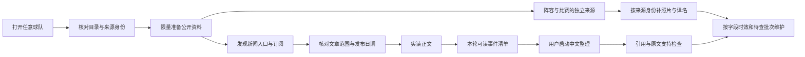

# 看台 V8.3：用陌生球队验收通用能力

2026-10-01开始，2026-10-02完成本轮代码与验收。用户复核发现：关注球队尚有失败，其他球队的新闻、名单与照片明显更差。V8.2 的 96/100 只建立在少数本机球队与单篇巴萨模型验收上，不能代表整个产品的质量。本轮撤回它作为全目录质量结论的用途，保留当时的验收事实。

## 设计依据

关注表示用户的兴趣，只改变维护优先级，不能决定数据能力。一支陌生球队首次打开，必须走与关注球队相同的身份核对、来源发现、读取和生成流程。球队目录登记了入口，也不代表入口可读、消息可发现或正文可交付。

这里的核对证明身份、权限、引用和来源一致性，不替用户裁决报道真伪。模型负责中文表达，球队、赛季、成员关系和照片身份由来源数据提供。

## 已实施的方法调整

| 问题 | 通用处理 |
| --- | --- |
| Windows 代理存在但请求仍直连超时 | 所有已审核固定新闻与 ESPN 数据路径明确使用系统 HTTPS 代理；自定义来源保留独立的地址安全检查 |
| 首页能访问却找不到非英文新闻 | 按同源文章结构、新闻卡片、公开声明的订阅与新闻入口发现；禁止执行页面脚本或信任任意嵌入链接 |
| 国际总订阅漏掉本国小球队 | 增加 TMW 综合与意甲、FootMercato 三个声明订阅，全部球队共享；同一媒体多频道合并轮转配额，去重后再判断是否需要搜索 |
| 日期缺失导致近期消息全被排除 | 限量读取候选核对日期；保存来源声明的精度。只声明日期时保留日期，具体时刻和时区仍未知 |
| 更新先反复跑旧失败稿 | 先取得本轮来源，再限定本轮事件的报告队列；同来源、同模型失败不会被刷新批量重授权 |
| 单篇重试扩成其他稿件生成 | 报告队列接受硬范围；已完成和正在生成的稿件不因重试启动新工作 |
| 未关注球队长期没有名单 | 前端进入球队后请求资料准备；GET 只读，准备过程不调用模型、不改关注关系；最近访问球队进入有界维护队列 |
| 所有球员都绕过数据源照片 | 同源球员 ID 图片、源提供的球员选择器、官网目录、独立身份核对来源分阶段补齐；不拼造图片地址 |
| 一小时才继续查剩余照片 | 未查批次与来源故障分开；正常来源约一分钟后接续，另一个来源故障不阻塞它 |
| 静态中文名字没有出处 | 已核查读法优先；没有出处保留原名。动态补齐也必须来自已核对身份的来源字段 |
| 界面只有失败与三个零 | 分开显示索引、相关候选、近期候选、正文读取与中文稿件；失败不重复算成待处理 |
| 更新后旧页面模块失效出现白屏 | 局部错误边界保留主导航，提供刷新恢复；迟到导入错误不自动打断其他页面或清草稿 |
| 旧缓存复活撤回照片 | ESPN 按全局球员身份记录撤回；Wikimedia 公共读取联查当前身份与 Commons 许可撤回，清图片及引用入口 |

正文仍只进入有容量和有效期限制的进程缓存。中文结果、链接、日期、哈希与必要核对信息可以持久保存；用户手写记录、加密凭据和已证明的旧中文结果保留。

## 验收规则

1. 全目录 96 支球队都要通过同一冷启动路由与来源身份合同，不能在代码中检查是否关注后改变输出。
2. 真实验收使用固定留出样本，覆盖五个联赛、强队与小队。每一支球队分别记分母，失败样本不能被换掉。
3. 采集链逐步计数：索引可用 → 本队候选 → 范围与日期 → 正文实读 → 中文交付。页面 HTTP 200 和旧缓存不等于本轮成功。
4. 无消息、日期未知、范围拒收、来源故障和正文失败分别报告；不能用“空成功”掩盖失败，也不能把真实未知补成事实。
5. 关注与未关注的两份独立冷库，在相同来源输入下必须给出相同正文身份、哈希和采集结果。
6. 照片验收检查每个已展示头像的身份依据、出处与权利说明；未处理、真实缺图与网络加载失败分别展示。
7. 自动回归全部使用临时数据库和替身模型。公开联网与真实模型验收独立、限量；密钥不回显，原文不落盘。
8. 完整测试、界面测试、正式构建和桌面／窄屏验证必须通过。综合分不能抵消身份错配、隐藏来源泄漏、事实编造或错误的成功状态。

## 本轮证据

脚本 `scripts/accept-generalization.py` 默认只生成验收计划，只有 `--live` 才访问公开来源；不读取用户配置、不调用付费模型、不修改用户数据库。固定样本为曼联、布莱顿、马竞、赫塔费、那不勒斯、乌迪内斯、多特、美因茨、里尔、昂热、埃弗顿、塞尔塔、博洛尼亚、奥格斯堡、勒阿弗尔。

| 验收 | 结果与实际范围 |
| --- | --- |
| 完整离线回归 | 1191 项通过，0失败、0错误、0跳过，119.420秒 |
| 界面与构建 | 38项通过；TypeScript与Vite正式构建通过 |
| 全目录合同 | 96队冷启动路由、严格球队/赛季/球员ID阵容合同；相同源输入下关注/未关注结果一致；全部模拟数据，不冒充现网 |
| 固定15队真实资料 | 15/15取得真实阵容；11/15取得七日内正文；两项分别计数，不把阵容成功当作新闻成功 |
| 实际中文稿 | 曼联BBC英文源、美因茨官网德文源各一篇，使用现有加密模型配置共5次物理请求；生产写作流程、引用硬核对与原文支持核对通过；美因茨正文标记partial、时间仅到日期，保留限制 |
| 分批照片 | 独立冷库曼联14→26→30/30；美因茨10→20→22/28，缺图不造图；有界推进三批，耗时不包含真实调度等待 |
| 桌面与窄屏 | 未关注赫塔费31名真实球员、44场比赛；1440/390px阵容搜索、详情、动态、助手8场景无整体/控件横向溢出；真实浏览器模拟模块失败后导航与恢复按钮可用，刷新后恢复 |
| 数据与回退 | 数据库与key成对备份在Git忽略目录；回退标签`rollback/generalization-20261001-193002`；仅main；用户Windows打包工作保留 |

最新真实新闻零产出样本仍保留：布莱顿11条近期索引但正文缺少可靠主文章绑定；昂热当前已查来源无七日内文章；埃弗顿官网不可读、其他已查源无候选；博洛尼亚官网拒绝访问、当轮其他候选无近期可读正文。此前TMW单独探测曾取得博洛尼亚一篇，不能据此替换最新零产出记录。所有结果是有限时点观察，不证明全世界没有新消息，也不证明来源永久可用。

证据在Git忽略的`output/qa/`：`v83-full-release.json`、`v83-public-15-release.json`、`generalization-model-manchester-united.json`、`generalization-model-mainz.json`、`v8.3-progressive-portrait-acceptance.json`、`generalization-browser-layout.json`、`v83-real-chunk-recovery.json`。外部正文未进入持久原文库，模型key未输出。

原始成功计数不能直接代表产品已超过 95 分：真实无近期消息、尚未读全的来源、照片缺失和仅少量模型验收都必须保留。全目录模拟合同通过，也不能冒充全目录现网通过。
